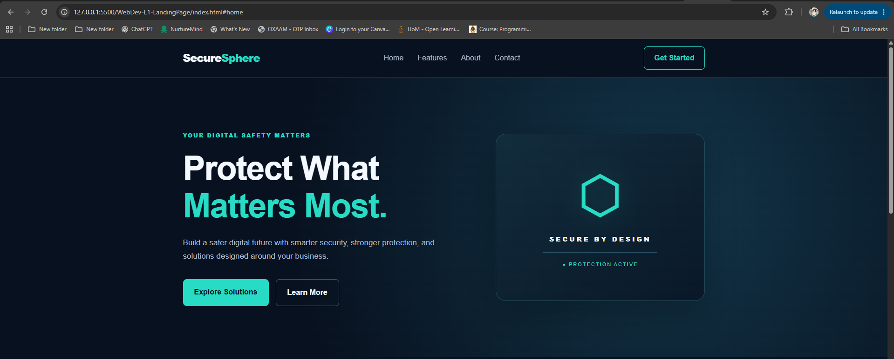
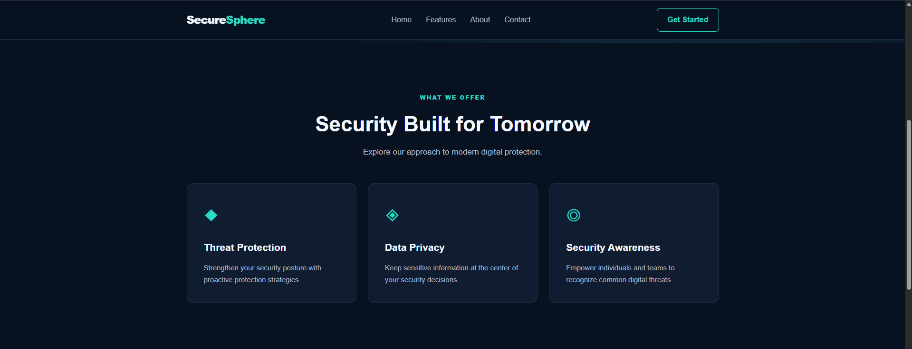
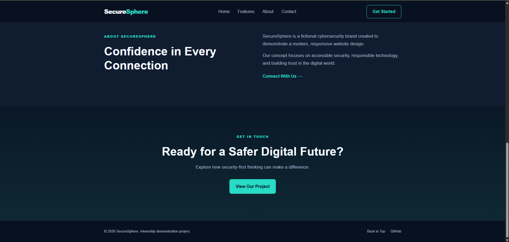
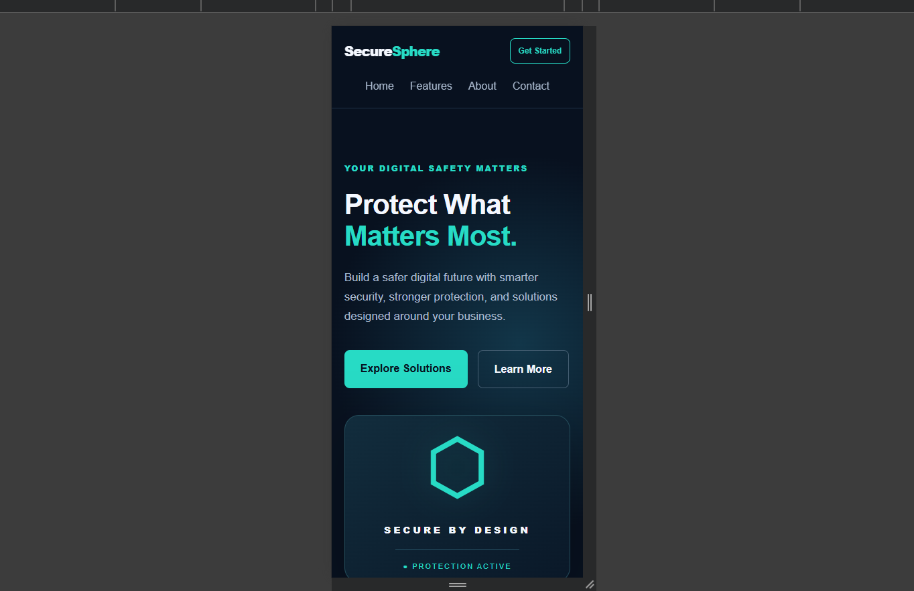


# SecureSphere — Responsive Landing Page

## Oasis Infobyte Internship

**Intern:** Tharun Sasanka  
**Track:** Web Development & Designing  
**Level:** 1  
**Task:** 1 — Landing Page

## Project Overview

SecureSphere is a responsive landing page created for a
fictional cybersecurity brand.

The project demonstrates modern website design using
HTML5 and CSS3, with an emphasis on responsiveness,
navigation, accessibility, and visual consistency.

## Features

- Sticky navigation bar
- Hero section with call-to-action buttons
- Three cybersecurity feature cards
- About section
- Contact section
- Footer with GitHub repository link
- Responsive desktop and mobile layouts
- Smooth scrolling between page sections

## Technologies Used

- HTML5
- CSS3
- CSS Flexbox
- CSS Grid
- Media Queries

## Project Structure

WebDev-L1-LandingPage/
- index.html
- style.css
- README.md
- screenshots/

## How to Run

1. Download or clone the OIBSIP repository.
2. Open the WebDev-L1-LandingPage folder.
3. Open index.html in a web browser.

Alternatively, use the Live Server extension in VS Code.

## Screenshots

### Homepage

### Features

### Contact and Footer

### Mobile View

## Testing

The layout was visually reviewed on desktop and
mobile browser viewports.

Navigation links and call-to-action buttons use
HTML anchor links.

## Live Demo

Deployment pending.

## Author

Tharun Sasanka

GitHub:
https://github.com/tharunsasanka/OIBSIP

## Disclaimer

SecureSphere is a fictional cybersecurity brand
created for educational purposes.
