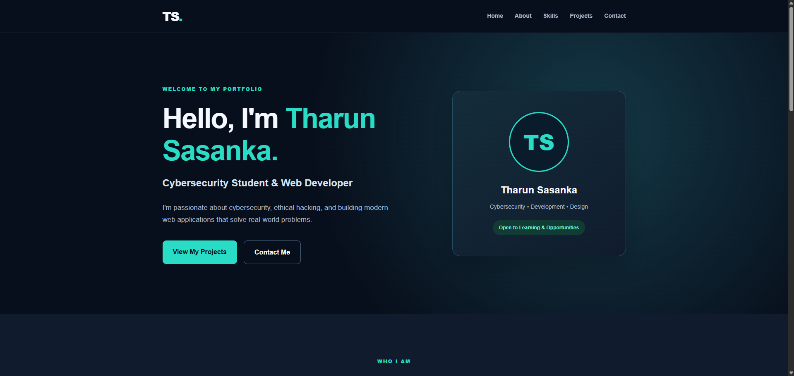
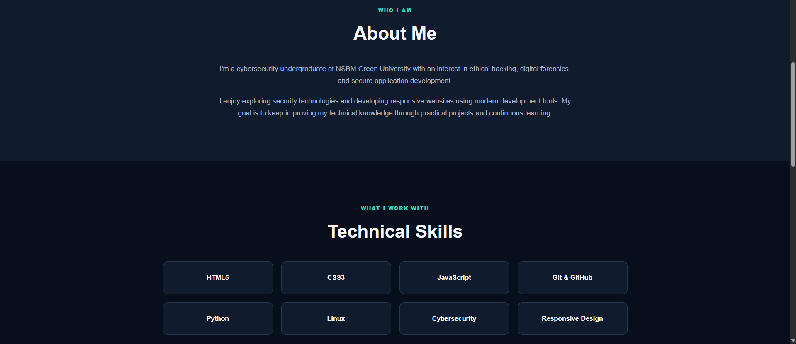
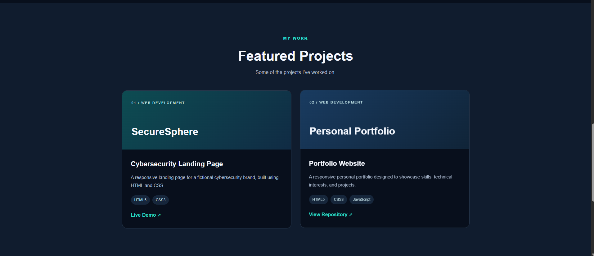
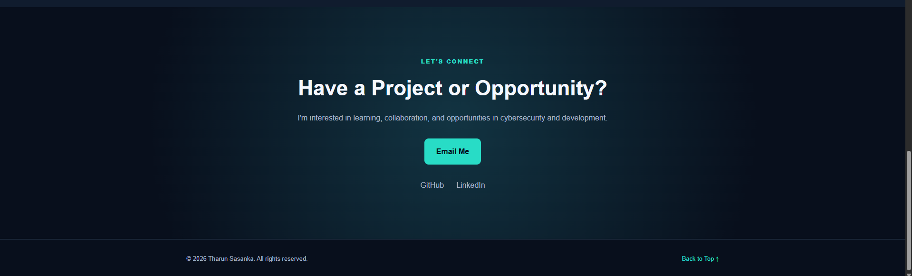
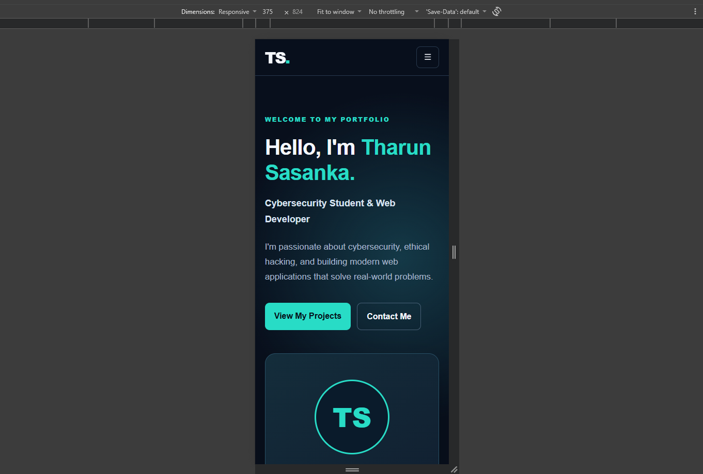
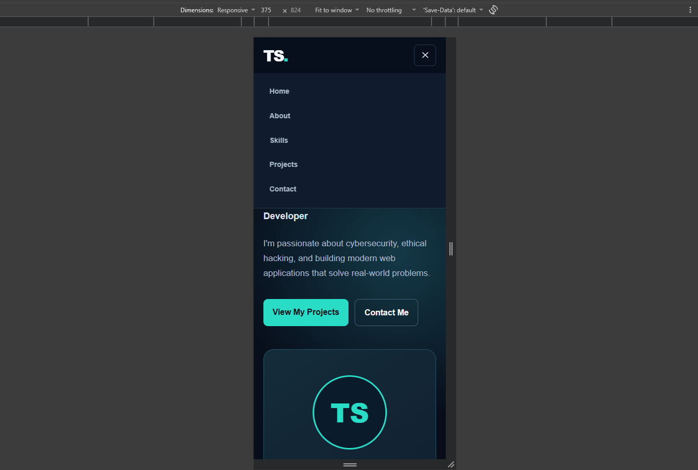


# Personal Portfolio — Tharun Sasanka

## Oasis Infobyte Internship

**Intern:** Tharun Sasanka  
**Track:** Web Development & Designing  
**Level:** 1  
**Task:** 2 — Personal Portfolio

## Project Overview

This project is a responsive personal portfolio website
developed as part of the Oasis Infobyte internship.

The website introduces my background in cybersecurity
and web development while showcasing my technical
skills, projects, and contact information.

## Features

- Responsive navigation bar
- Interactive mobile hamburger menu
- Hero section with profile avatar
- About Me section
- Technical skills grid
- Featured projects section
- Contact information and social links
- Smooth scrolling navigation
- Responsive desktop, tablet, and mobile layouts
- Hover effects and consistent visual styling

## Technologies Used

- HTML5
- CSS3
- JavaScript
- CSS Flexbox
- CSS Grid
- CSS Media Queries
- Git and GitHub

## Project Structure

WebDev-L1-PersonalPortfolio/
- index.html
- style.css
- script.js
- README.md
- assets/
  - images/
- screenshots/

## How to Run

1. Clone the repository:

   git clone https://github.com/tharunsasanka/OIBSIP.git

2. Open the WebDev-L1-PersonalPortfolio folder.

3. Open index.html in your browser.

Alternatively, use the Live Server extension
in Visual Studio Code.

## Screenshots

### Homepage

### About and Skills

### Projects

### Contact and Footer

### Mobile View

### Mobile Navigation

## Testing

The website was visually reviewed on desktop
and mobile browser viewports.

The mobile navigation was tested for menu opening.
Further link and responsive checks should be
completed before final submission.

## Live Demo

The Personal Portfolio is deployed using GitHub Pages.

[View Live Portfolio](https://tharunsasanka.github.io/OIBSIP/WebDev-L1-PersonalPortfolio/)

## Source Code

[View Task 2 Source Code](https://github.com/tharunsasanka/OIBSIP/tree/main/WebDev-L1-PersonalPortfolio)

## Source Code

https://github.com/tharunsasanka/OIBSIP

## Author

Tharun Sasanka

GitHub:
https://github.com/tharunsasanka

## Internship

Oasis Infobyte — Web Development & Designing

Level 1 — Task 2
