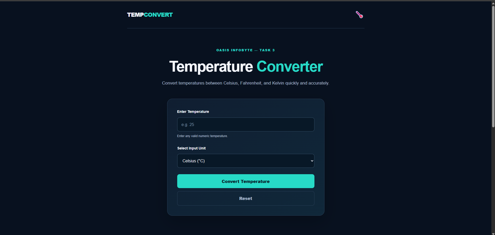
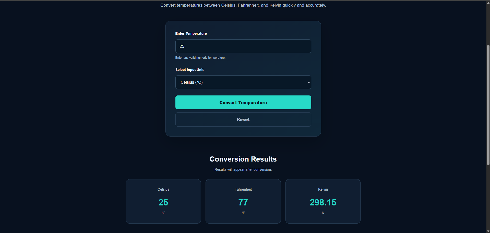
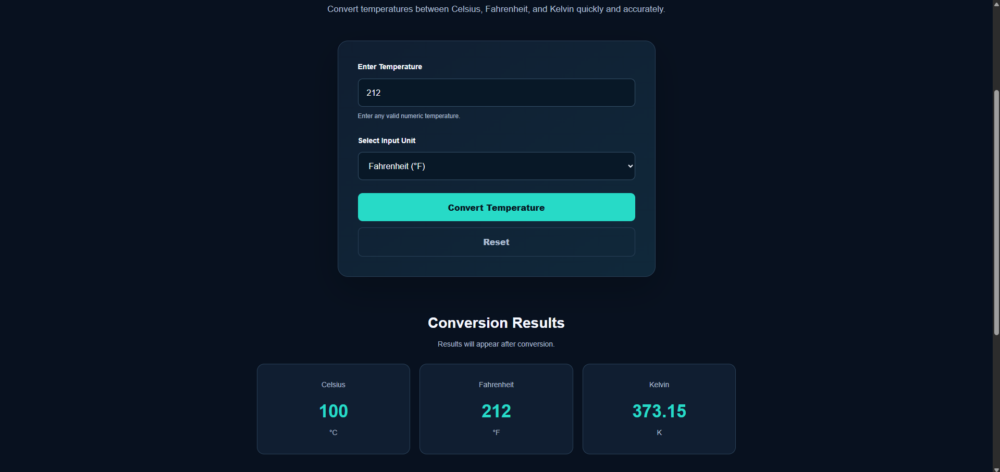
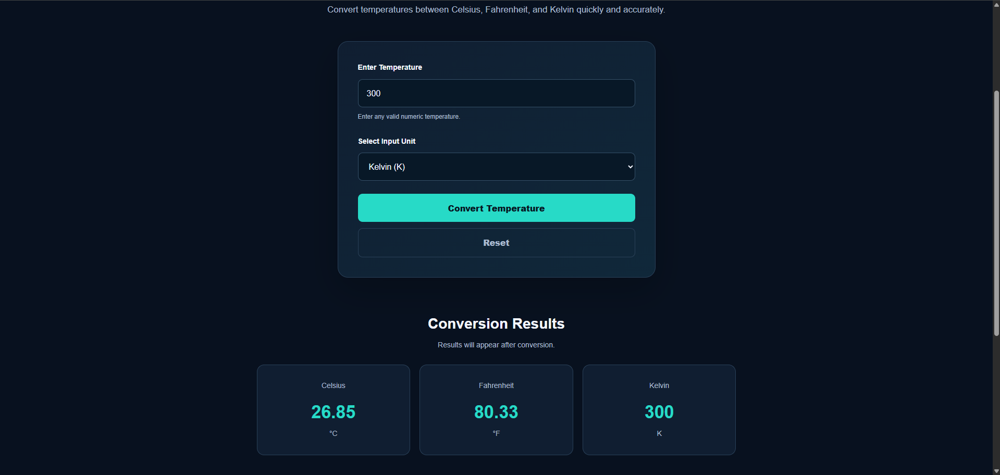
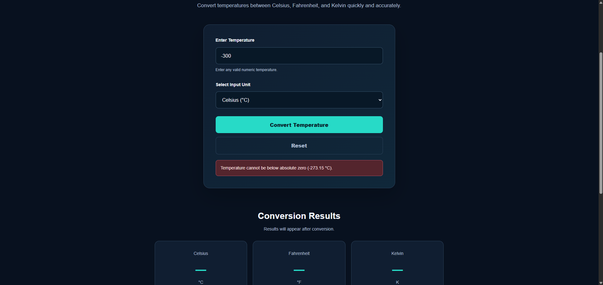
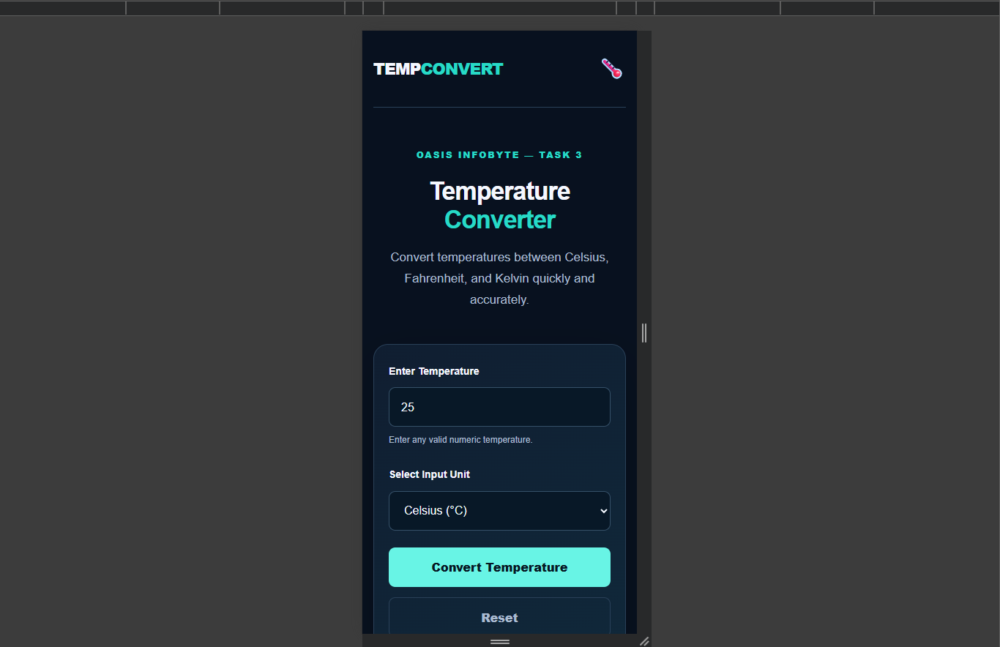


# TempConvert — Temperature Converter Website

## Oasis Infobyte Internship

**Intern:** Tharun Sasanka  
**Track:** Web Development & Designing  
**Level:** 1  
**Task:** 3 — Temperature Converter Website  

## Project Overview

TempConvert is a responsive temperature conversion
application developed using HTML5, CSS3, and JavaScript.

The application allows users to convert temperatures
between Celsius, Fahrenheit, and Kelvin.

It includes input validation, absolute-zero checks,
and a responsive interface.

## Features

- Temperature input field
- Celsius, Fahrenheit, and Kelvin selection
- Convert Temperature button
- Results displayed in all three units
- Empty-input validation
- Invalid numeric input handling
- Absolute-zero validation
- Reset functionality
- Responsive desktop and mobile layouts
- Temperature conversion formulas

## Technologies Used

- HTML5
- CSS3
- Vanilla JavaScript
- CSS Flexbox and Grid
- CSS Media Queries
- Git and GitHub

## Temperature Conversion Formulas

### Celsius to Fahrenheit

F = (C × 9/5) + 32

### Fahrenheit to Celsius

C = (F - 32) × 5/9

### Celsius to Kelvin

K = C + 273.15

### Kelvin to Celsius

C = K - 273.15

## Input Validation

The application rejects temperatures below
absolute zero:

- Celsius: -273.15 °C
- Fahrenheit: -459.67 °F
- Kelvin: 0 K

It also displays an error message for empty
or invalid input.

## Project Structure

WebDev-L1-TemperatureConverter/
- index.html
- style.css
- script.js
- README.md
- screenshots/

## How to Run

1. Clone the repository:

   git clone https://github.com/tharunsasanka/OIBSIP.git

2. Open the WebDev-L1-TemperatureConverter folder.

3. Open index.html in a web browser.

Alternatively, open the project using the
Live Server extension in Visual Studio Code.

## Screenshots

### Homepage

### Celsius Conversion

### Fahrenheit Conversion

### Kelvin Conversion

### Input Validation

### Mobile Responsive View

## Functional Testing

The following test cases are provided for
verification:

| Input | Unit | Expected Result |
|-------|------|-----------------|
| 25 | Celsius | 77 °F, 298.15 K |
| 100 | Celsius | 212 °F, 373.15 K |
| 32 | Fahrenheit | 0 °C, 273.15 K |
| 300 | Kelvin | 26.85 °C, 80.33 °F |
| -300 | Celsius | Validation error |
| -500 | Fahrenheit | Validation error |
| -1 | Kelvin | Validation error |

## Live Demo

TempConvert is deployed using GitHub Pages.

[View Live Temperature Converter](https://tharunsasanka.github.io/OIBSIP/WebDev-L1-TemperatureConverter/)

## Source Code

[View Task 3 Source Code](https://github.com/tharunsasanka/OIBSIP/tree/main/WebDev-L1-TemperatureConverter)

## Source Code

https://github.com/tharunsasanka/OIBSIP

## Author

Tharun Sasanka

## Disclaimer

This project was created for educational
purposes as part of the Oasis Infobyte
Web Development & Designing internship.
